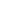

<p align="center">
  
</p>

<h1 align="center">AnimeTab</h1>

<p align="center">
  An anime-themed new tab page for Chrome with wallpapers, a clock, daily quotes, airing countdowns and focus tools.
</p>

<p align="center">
  <a href="https://github.com/ren0777/AnimeTab-ChromeExtension/actions/workflows/build.yml"></a>
  
  
  
  <a href="LICENSE"></a>
</p>

---

## Overview

AnimeTab is a Manifest V3 Chrome extension that replaces the default new tab page with an anime dashboard. It shows a rotating wallpaper, a live clock with Japanese greetings, a quote of the day, a grid of quick links you can edit, and a countdown to the next episodes of currently airing shows (from AniList).

**Privacy:** AnimeTab has no accounts, no tracking and no third-party analytics. Preferences and anonymous feature counters are stored in `chrome.storage.local`. Backgrounds you upload are kept in the extension's IndexedDB. See [privacy.html](privacy.html) for the full policy.

## Features

### Wallpapers
- **Four sources that need no API key:**
  - **Anime portraits** from nekos.best. You can pick a type: Waifu, Neko, Kitsune, Husbando or Any.
  - **Anime scenes** from wallhaven's anime category, at full resolution.
  - **Anime landscapes** from wallhaven, filtered by scenery tags.
  - **Photo of the day** from Bing's daily archive.
- **Instant paint:** each new tab shows the cached wallpaper right away, then crossfades to a fresh one.
- **Fallback chain:** if a source fails, AnimeTab tries the next one. If they all fail, it uses wallpapers bundled with the extension.
- **Controls:** you can shuffle, pin the current image, save it to disk or upload your own. All requests are SFW-filtered.

### Personalization
- **Mood themes:** Wano, LoFi, Cute, Romantic and Fighting. AnimeTab picks one from the wallpaper's colors, or you can set it yourself.
- **Clock and greeting:** 12-hour or 24-hour time, with a greeting that changes through the day (おはよう / こんにちは / こんばんは / おやすみ).
- **Search bar:** choose Google, DuckDuckGo, YouTube or AniList. Your choice is remembered.
- **Quick links:** add, remove and reorder tiles. Favicons are fetched automatically.
- **Share my setup:** export your links, theme, search engine and clock format as a code that friends can import.

### Anime and productivity
- **Airing Soon and watchlist:** countdowns for popular shows this season, plus up to 12 shows you pin yourself (searched on AniList).
- **Focus timer:** 15, 25, 45 or 60 minutes. It keeps running across tabs and plays a chime when it finishes.
- **Ambient sound:** rain, vinyl and ocean sounds generated with the Web Audio API (no audio files). It is off by default and never starts on its own.
- **Daily streak:** counts the consecutive days you've opened a tab.
- **Quote of the day:** a new quote each day from a curated list.

### Community
- **Invite hub:** one-tap sharing to X, Telegram, WhatsApp, Reddit and Discord. Sharing unlocks cosmetic extras: a neon rain overlay, a night-drive quote mode and a hologram clock skin.
- **Merch card:** curated anime merchandise with an affiliate disclosure on the card. Links open only when you click them, and you can hide the card.

## Installation

### From source

```bash
git clone https://github.com/ren0777/AnimeTab-ChromeExtension.git
cd AnimeTab-ChromeExtension
npm install
npm run build
```

Then load it in Chrome:

1. Open `chrome://extensions/`.
2. Turn on **Developer mode**.
3. Click **Load unpacked** and select the project folder.
4. Open a new tab.

## Development

| Command | Description |
| --- | --- |
| `npm run dev` | Rebuild automatically on changes (webpack watch mode) |
| `npm run build` | Build the production bundle into `dist/` |
| `npm test` | Run the unit tests (`node:test`) |
| `npm run lint` | Run ESLint over `src/` and `tests/` |
| `npm run verify` | Run lint, tests and build together |
| `npm run package` | Build the Chrome Web Store zip into `release/` |
| `npm run release [minor]` | Bump the version, run all checks, package, commit and tag |

**Tech stack:** React 18, Framer Motion and webpack 5, with a Manifest V3 service worker.

CI runs lint, tests, the build and packaging on every push and pull request. The store zip is uploaded as a build artifact.

### Project structure

```
├── manifest.json      # Extension manifest (MV3)
├── background.js      # Service worker
├── newtab.html        # New tab page (loads dist/bundle.js)
├── src/               # React app and pure logic modules (src/lib)
├── tests/             # Unit tests
├── assets/            # Icons, bundled fonts, fallback wallpapers
├── scripts/           # Packaging, release, icon and font tooling
├── quotes.json        # Quote of the day data
└── merch.json         # Merch card catalog
```

## Configuration

To earn affiliate commission on the merch card, set your Amazon Associates tag in `merch.json`:

```json
{ "affiliateTag": "your-tag-20" }
```

If the tag is empty, the links still work but are not tagged.

## Documentation

- [DEV-README.md](DEV-README.md): architecture and the release process
- [TESTING.md](TESTING.md): manual QA checklist
- [TROUBLESHOOTING.md](TROUBLESHOOTING.md): common problems and fixes
- [CHANGELOG.md](CHANGELOG.md): release history
- [privacy.html](privacy.html): privacy policy

## Credits

Wallpapers come from [nekos.best](https://nekos.best), [wallhaven](https://wallhaven.cc) and [Bing](https://www.bing.com). Airing schedules come from the [AniList API](https://anilist.co). All artwork belongs to its respective creators.

## License

Copyright © 2026 AnimeTab Team. All rights reserved.

The source is published for viewing only. You may not copy, modify, redistribute or republish this code or any part of it (including as another extension) without written permission. See [LICENSE](LICENSE).
